# Seeky · DeepSeek Sprite Animation Kit

**English** | [简体中文](README.zh-CN.md)

A starter kit for animating a hand-painted character frame by frame with [p5.js](https://p5js.org) and [p5.brush](https://github.com/acamposuribe/p5.brush). This version swaps the original mascot, Clawd, for **Seeky, the DeepSeek sprite**: a little floating whale in DeepSeek blue.

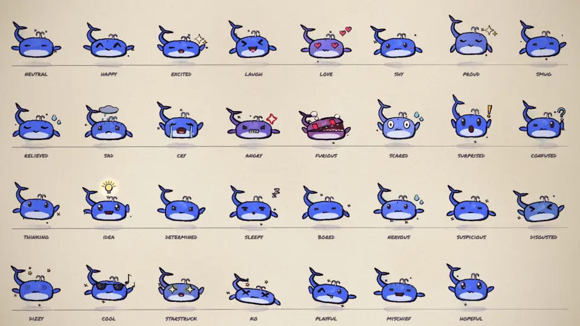

## Credits and origin

> **This project is not original work.** The original author is **John Heibel**, and the original repository is [JohnHeibel/ClaudeAnimationBase](https://github.com/JohnHeibel/ClaudeAnimationBase) (MIT license).
> The rendering engine, the brush and paper textures, the animation helpers, the emotion system, the offline renderer and the method in [ANIMATION_GUIDE.md](ANIMATION_GUIDE.md) all come from him. The original project grew out of his music video [I'm Upping My P(doom)](https://github.com/JohnHeibel/PDoomVideo) and an analysis of what language models do well and badly when they animate.
> The headless Linux rendering and the fix for outlines in zoomed-in shots come from contributor Clement Dumas ([@Butanium](https://github.com/Butanium)).
>
> I only borrowed the approach: I redesigned the character and added an interactive preview page. See [LICENSE](LICENSE); the original author's copyright notice is kept as the MIT license requires.

The DeepSeek name and whale logo belong to DeepSeek. Seeky is a fan character inspired by them, not an official mascot.

## The character

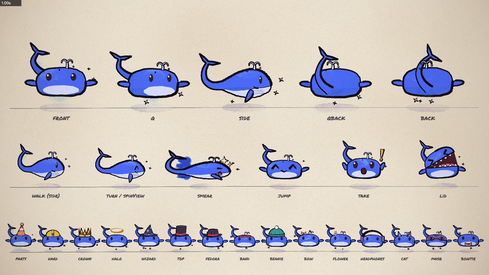

| Part | Design |
|---|---|
| Inspiration | The blue whale in the DeepSeek logo |
| Colours | DeepSeek blue `#4D6BFE`; shade `#2E46C2`; highlight `#9DAEFF` |
| Body | A soft body, round on top and flatter underneath (10u wide, 6u tall), with a pale belly |
| Tail | Curls up behind the body into a two-lobed fluke, in the pose of the logo; it sways gently at rest and beats harder when swimming |
| Limbs | Two flippers and no legs; Seeky floats about 2u above the ground, and its shadow shrinks as it rises |
| Face | Round eyes with a catchlight; no mouth at rest; when furious the whole top of the head opens like a whale's gulp |
| Sprite touches | A little water spout on the head that hops on the beat, and a few tiny stars that wink in and out around it |

**The profile is drawn on its own**, not squeezed from the front view: a blunt head and a body that tapers toward the tail, with the stalk, the fluke and the body sharing one outline, so the tail grows out of the body. The top edge of the pale throat doubles as the mouth line, with a small smile at the corner; a few throat grooves run along the belly; the pectoral fin is a long leaf that sweeps back and down.

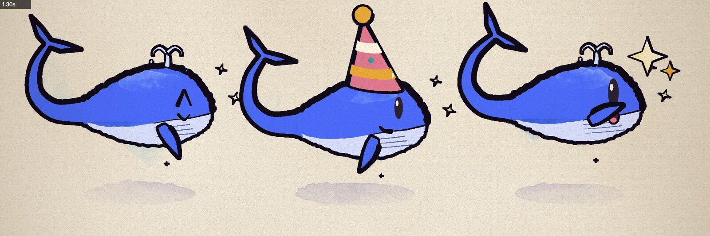

**In the 3/4 views the far side is a soft shade.** It is darkest at the outer edge and fades toward the face, with no line between the front and the side.

**The tail's depth follows the view.** The tail grows from the rear of the body. From the front, 3/4 and side it is behind the body; from behind and 3/4 behind it is the part nearest the viewer, so it is drawn in front of the body, growing out of the lower rear and curling up over the back with the fluke on top.

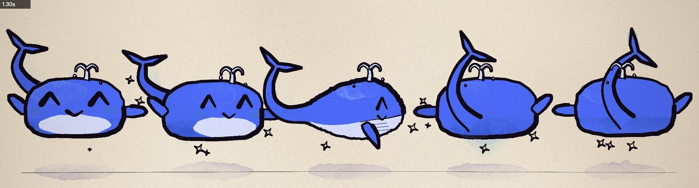

### Hats change with the view

Hats are not squeezed from the front view either: each view has its own drawing (the code is in [src/hats.js](src/hats.js)). Every part of a hat is placed by its azimuth round the head (0° is the nose, positive toward the whale's right side), and the current view works out where that part lands on screen and how near the viewer it is. So the same hat shows different parts, facing different ways and overlapping differently, from each angle.

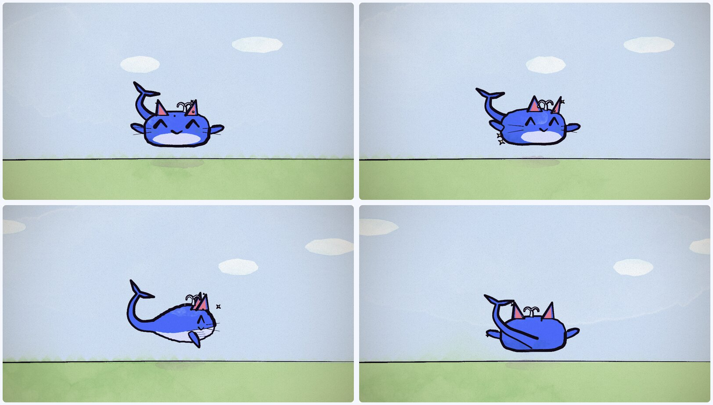

| Hat | How it changes with the view |
|---|---|
| party | Tipped back; its stripes and dots move round as it turns, and the far ones are hidden by the cone |
| hard | The visor follows the nose: it faces the viewer from the front, sticks out forward in profile, and from behind only the neck guard and the adjuster dial show; the ridge on top is an upright band from the front and an arc in profile; the blue badge is on the front only |
| crown | The five spikes stand where they really are, far ones behind and near ones in front; only the gems facing the viewer are painted |
| halo | Hovers over the head, tipped back: the far half is thin and pale, the near half bold and bright |
| wizard | The tip bends back and droops: to the left in profile, toward the viewer from behind; a gold buckle on the front, a crescent on the back |
| hood | The lining frames the face only; from behind the hood drapes down over the nape, with a seam down the middle |
| top / fedora | The top hat's buckle is on the front; the fedora's brim curls up at the sides, the crease on top runs up and down from the front and across in profile, and a feather sits on the right side |
| band / sweatband | The headband's knot is at the back of the head: invisible from the front, a bow with streaming tails in profile, centred from behind; the sweatband has a star on the front and a seam at the back |
| beanie | The knitted ribs sweep round as it turns; the pom on top leans back |
| bow / flower | Worn on the right side of the head: on the left from the front, face-on in 3/4, and from behind you see the green back of the flower |
| headphones | A full arch from the front; in profile just one upright band and one cup, the other hidden by the head |
| cat | In profile one ear stands in front of the other, the far one peeking out behind; the whiskers only show in views that show the face |
| mask / masq | The tie runs round to the back of the head: a strap and a knot behind the head in profile, a band and a bow across the back from behind |
| bowtie | Narrower in profile, hidden from behind |

Where each hat sits comes from the outline of the head in that view.

**From behind, the tail makes room for the hat.** In the back and 3/4 back views the tail is drawn in front of the body and rises over the back of the head, where it would hide a hat. So with a hat that needs that space (every hat and mask except the bow, the flower and the bowtie) the tail curls up to the left of the head instead (`tailAside`) and is drawn behind the hat; the bow, the flower and the bowtie are out of the way, so the tail stays where it is.

**How this was checked.** A script compared each render pixel by pixel with the same render without a hat.

- **Covering the eyes**: all 18 hats and face pieces, in the 3 views that show the face, with 6 expressions (neutral, happy, sad, surprised, angry, sleepy), counting only the eyes' own ink. At most 3.5% of an eye is covered (the wide surprised eyes, in profile, under a beanie), and mostly under 1%. Behind a mask the eyes keep at least 90% of their contrast against a bare face.
- **Tail and hat hiding each other** (back and 3/4 back): the tail hides at most 0.3% of a hat (3.4% for the flower from behind). Hats hide up to about 24% of the tail for the hood, about 12% for the headphone cup, about 3% for masks, and next to nothing otherwise.

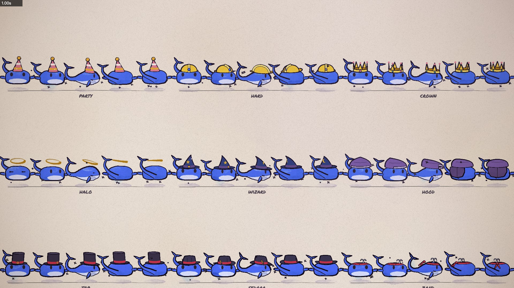

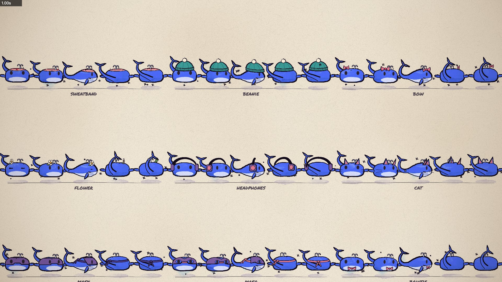

Clawd's whole API is still there: 5 key views, 31 emotions, 24 eyes, 16 mouths, 18 hats and face pieces, 18 emotes and 11 dances (plus `mix`, which changes style every two bars).

## The preview page

Run `npm install`, then open [preview.html](preview.html) in Chrome. It renders Seeky live with the real brush engine. The page is in English by default; the switch at the top right changes it to Chinese and remembers your choice, and `preview.html?lang=zh` opens it in Chinese directly.

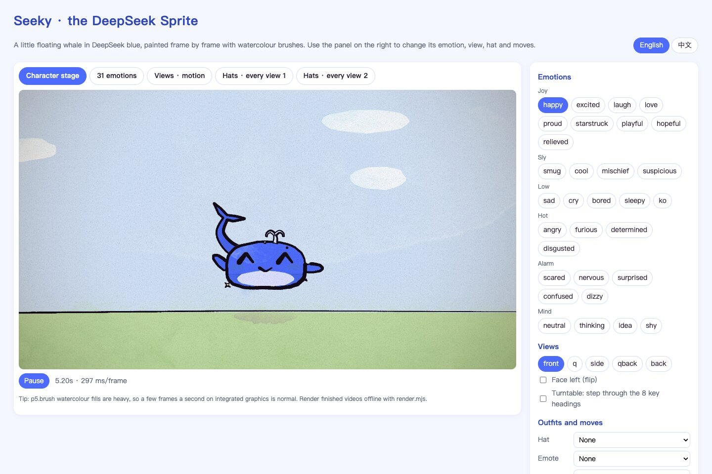

- **Emotions**: click to switch. Every change is acted: a squint for anticipation, a take, then a settle into the new motion.
- **Views**: front, 3/4, side, 3/4 back and back. Flip it to face left, or turn on the turntable to step through all 8 headings.
- **Outfits and moves**: hats, emotes, dances (including swimming), size and backgrounds (clear sky, seaside, night, plain paper). When the view changes, or the turntable turns, the hat switches to its drawing for that angle.
- **Model sheets**: the "31 emotions", "Views · motion" and two "Hats · every view" tabs.

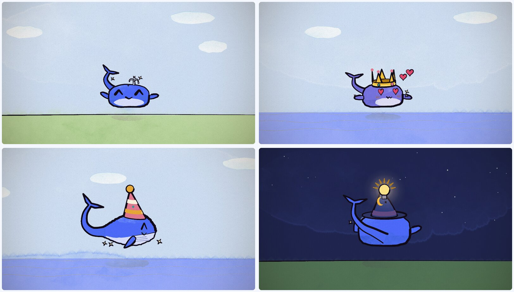

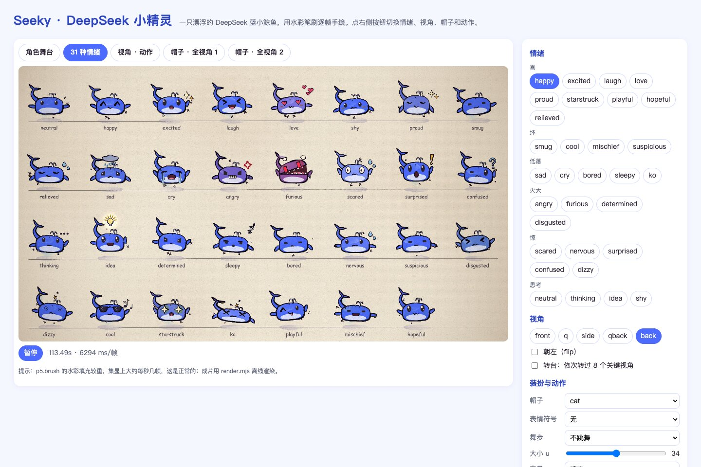

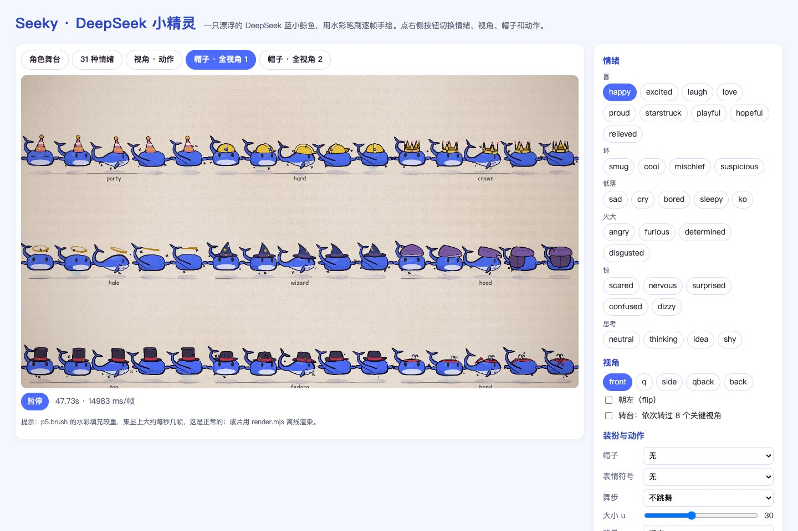

Watercolour fills are heavy on the GPU. A frame of the character stage takes about 0.1–0.3 s and a frame of a model sheet a few seconds, so the sheet tabs redraw less often. Render finished videos offline, as below.

## Make an animation

Open the project in Claude Code (or any coding agent) and say what you want:

> Read ANIMATION_GUIDE.md, then make a 15-second video of Seeky trying to catch a butterfly.

The model storyboards first, builds shot by shot, renders contact sheets to check its own work, and writes `out/video.mp4`. [ANIMATION_GUIDE.md](ANIMATION_GUIDE.md) holds the rules it follows: handmade, alive, one piece, no text, transitions at every seam, something happens in every shot, plus timing and the principles of character animation.

## Run it yourself

You need Node.js, Google Chrome and ffmpeg.

```bash
npm install
node render.mjs --clip --out=out/video.mp4          # render the 11-second demo
node render.mjs --loop=emotions --sheet=1 --cols=1 --w=1920 --out=out/emotions.jpg   # the emotions model sheet
```

- Open [studio.html](studio.html) in Chrome to scrub through the demo; add `?loop=emotions`, `?loop=views`, `?loop=hats` or `?loop=hats2` to see a model sheet.
- If Chrome isn't in a standard location, pass `--chrome=<path>` or set `CHROME_PATH`.
- Without a dedicated GPU, p5.brush's watercolour fills take seconds per frame; you can ask the model to use other fills instead.
- On Linux, `render.mjs` adds `--no-sandbox`. With no GPU at all, add `--soft-gl`; on a headless NVIDIA machine, add `--gpu-angle=gl-egl` (or `vulkan`), and run `node gpu_probe.mjs <chrome path>` to see which renderer you get.

## Use it in code

```js
seeky(960, 880, 26, feel('happy', t));                                    // one emotion, with its idle motion
seeky(960, 880, 26, { ...feel('love', t), view: 'q', hat: 'crown' });     // with a view and a hat
seeky(960, 880, 26, emotions(t, [[0, 'sleepy'], [1.9, 'surprised'], [2.5, 'idea']]));  // acted changes of mood
seeky(x, 880, 22, { ...feel('excited', t), view: 'side', walk: t });      // swimming in profile
```

Options only Seeky has: `hover` (float height), `tailWag` (extra tail swing), `spout` (0..1 spray strength; `false` hides it) and `noGlitter` (turns the little stars off). The full API is in [ANIMATION_GUIDE.md](ANIMATION_GUIDE.md).

## What's here

| Path | What it is |
|---|---|
| [ANIMATION_GUIDE.md](ANIMATION_GUIDE.md) | The rules, the workflow and the full API. Read it first (written by the original author, updated for the new character) |
| [preview.html](preview.html) | Interactive character preview |
| [src/seeky.js](src/seeky.js) | Seeky: views, emotions, eyes, mouths, emotes, dances |
| [src/hats.js](src/hats.js) | Hats and face pieces, each drawn for the view it is seen from |
| [src/core.js](src/core.js) | Painting, timing, motion helpers, camera, light, paper |
| [src/timeline.js](src/timeline.js) | Shots, loops and the brush-wipe transition |
| [src/config.js](src/config.js) | Length and tempo |
| [src/scenes/](src/scenes/) | Your video goes here (the demo is an example) |
| [render.mjs](render.mjs) | Headless renderer: contact sheets, frame strips, crops, stills, MP4 |
| [docs/](docs/) | Model sheets: [emotions](docs/emotions.jpg) ([animated](docs/emotions.webp)), [views and motion](docs/views.jpg), [every hat from every view](docs/hats.jpg) ([page 2](docs/hats2.jpg)), and [preview screenshots](docs/screenshots/) |

## Changes from the original

- `src/clawd.js` is now `src/seeky.js`. Everything about the look is rewritten: the body, tail, flippers, spout, stars, round eyes and the way the mouth opens. The emotion, emote and dance logic is the original author's.
- The side view has its own whale outline (`top / bot / bellyUp / tail` in `VIEWS.side`), with the body, stalk and fluke as one continuous outline.
- In the back and 3/4 back views the tail is drawn in front of the body (`tailFront`), growing out of the lower rear; in the other views it is behind the body.
- The far side in the 3/4 and 3/4 back views is a soft shade that fades from the outer edge toward the face; the ink line between the front and the side is gone.
- Hats moved from `seeky.js` to the new `src/hats.js` and are drawn per view (parts placed by azimuth round the head). Every view in `VIEWS` now has a `yaw` and a `fit` (where hats sit on the head). New model sheets: `LOOPS.hats` and `LOOPS.hats2`.
- The back and 3/4 back views have a second tail path, `tailAside`: with a hat that needs the space above the back of the head, the tail curls to the left of the head and is drawn behind the hat (`hatNeedsRoom` and `HAT_LOW` are in `hats.js`).
- Masks (`mask`, `masq`) are painted under the eyes, so the eyes still act. `studio.html` and `preview.html` load `src/hats.js` as well.
- `PAL` gains three DeepSeek blues, `ds / dsDk / dsLt`; the default brush wipe is blue.
- New: `preview.html` and `docs/screenshots/`; the model sheets in `docs/` are re-rendered.
- The README comes in English (this file, the default) and Chinese ([README.zh-CN.md](README.zh-CN.md)); the character description and API in ANIMATION_GUIDE are updated for the new character.

## License

[MIT](LICENSE). Copyright belongs to the original author, John Heibel; the derived parts are offered under the same MIT license.
