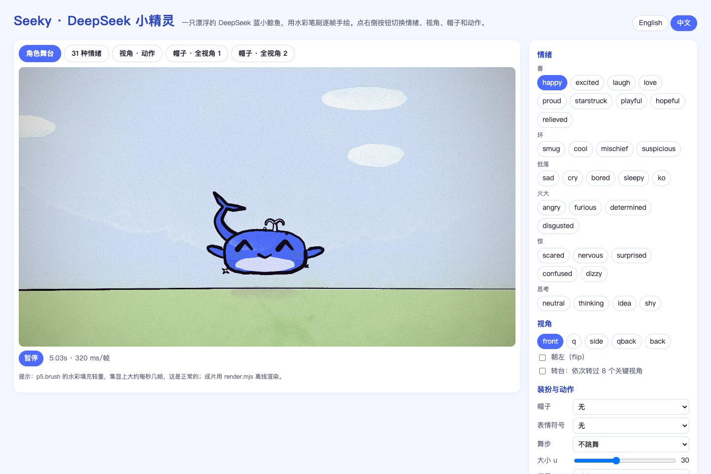

# Seeky · DeepSeek 小精灵动画套件

[English](README.md) | **简体中文**

用 [PixiJS](https://pixijs.com) 和 [p5.brush](https://github.com/acamposuribe/p5.brush) 的独立 GPU 引擎逐帧"手绘"角色动画的入门套件。这个版本把原项目的吉祥物 Clawd 换成了 **Seeky，DeepSeek 小精灵**：一只漂浮的 DeepSeek 蓝小鲸鱼。

**在线预览：** [角色交互预览](https://flynn-eye.github.io/DeepSeekAnimationBase/?lang=zh) · [11 秒故事演示](https://flynn-eye.github.io/DeepSeekAnimationBase/studio.html?lang=zh)（需要支持 WebGL2 的浏览器）。

## 运行 Pixi 版本

```bash
# 新机器首次运行：先构建同级 GPU 笔刷仓库。
(cd ../p5.brush && npm install && npm run build)
npm install
npm run dev
```

`package.json` 使用 `p5.brush: file:../p5.brush`，指向同级目录里的本地 Pixi 重写版。该 GPU 引擎**不是**公开 npm 上游 `p5.brush@2.2.3` 的功能；文中的 GitHub 链接用于上游归属引用。两个仓库需要并排放置。当前工作区已经构建，无需重复第一条命令；以后修改笔刷源码后，需重新构建同级仓库再刷新页面。

打开终端显示的本地地址，默认进入角色交互预览。点击 **观看故事演示** 可进入 [studio.html](studio.html) 的 11 秒动画，支持播放、暂停和拖动时间轴。页面从本地 `node_modules` 加载依赖，不再加载 p5.js 或远程 JavaScript；需要支持 WebGL2 的浏览器。

角色、姿势、情绪、帽子、故事时序及每秒 12 次的手绘抖动节奏保留。笔刷与水彩使用新的 GPU 算法，纹理和颜料效果**不会与旧 p5 版本逐像素一致**；本 README 中的图片仍是旧版本的参考图。页面显示 **PixiJS · GPU** 及 CPU/驱动绘制提交耗时，不等待 GPU 完成；该数值不等同 GPU 执行时间或实际 FPS，不能据此得出性能提升结论，也不承诺固定帧率。

实时播放调用 `window.renderFrame(t)`，不会每帧编码图片。离线渲染所用的 `window.renderAt(t, type, quality)`、`renderSheet(...)`、`window.ready` 和 `gpuInfo()` 保留；故事和模型表仍使用原角色 API，渲染后端改由 [src/pixi-runtime.js](src/pixi-runtime.js) 提供。

### GitHub Pages

每次推送到 `main`，[.github/workflows/pages.yml](.github/workflows/pages.yml) 都会部署预览页。CI 机器上没有同级的 `../p5.brush`，无法对本项目执行 `npm install`，所以工作流改为：按工作流里固定的版本（`PIXI_VERSION`，需与 `package-lock.json` 保持一致）从 npm 拉取 `pixi.js`，GPU 笔刷则使用提交在 [vendor/p5.brush/](vendor/p5.brush/) 里的构建产物。两者被复制到页面在本地加载的同一 `node_modules/...` 路径下，因此 `preview.html`（作为 `index.html`）、`studio.html` 和 `src/` 无需修改即可部署。

重新构建 `../p5.brush` 后，要同步一次 vendored 副本并提交，否则 Pages 上仍是旧笔刷：

```bash
(cd ../p5.brush && npm run build)
npm run vendor:brush
```

仓库设置里 **Pages → Source** 需选择 **GitHub Actions**。


## 致谢与来源

> **本项目不是原创。** 原作者是 **John Heibel**，原仓库为 [JohnHeibel/ClaudeAnimationBase](https://github.com/JohnHeibel/ClaudeAnimationBase)（MIT 协议）。
> 原 p5 渲染引擎、笔刷与纸张的实现思路、动画辅助函数、情绪系统、离线渲染器和 [ANIMATION_GUIDE.md](ANIMATION_GUIDE.md) 里的方法论出自原作者。本版本进一步将运行时迁移到了 PixiJS 和独立 GPU 笔刷引擎。原项目基于他的 MV [I'm Upping My P(doom)](https://github.com/JohnHeibel/PDoomVideo)，并分析了大模型做动画时的长处和短处。
> 无头 Linux 渲染和放大镜头描边的修复来自贡献者 Clement Dumas（[@Butanium](https://github.com/Butanium)）。
>
> 我只是借鉴了这套思路：重新设计角色形象，并加了一个交互式预览页。版权声明见 [LICENSE](LICENSE)，按 MIT 协议保留原作者署名。

DeepSeek 名称和鲸鱼 logo 归 DeepSeek 所有。Seeky 是受其启发的同人角色，不是官方形象。

## 角色设定


| 部位 | 设计 |
|---|---|
| 原型 | DeepSeek logo 的蓝色鲸鱼 |
| 主色 | DeepSeek 蓝 `#4D6BFE`；阴影 `#2E46C2`；高光 `#9DAEFF` |
| 身体 | 上圆下平的软糯身体（10u 宽、6u 高），浅色肚皮 |
| 尾巴 | 从身后向上卷起，末端是双叶尾鳍，和 logo 的姿势一致；平时轻摆，游动时摆得更大 |
| 四肢 | 两只鳍状小手，没有腿，离地约 2u 悬浮，影子随高度缩放 |
| 面部 | 圆眼睛带高光；静止时没有嘴；暴怒时整个上颌张开，像鲸鱼一口吞 |
| 精灵感 | 头顶喷水孔的小水花随节拍跳动；身边会闪现几颗小星星 |

**侧面轮廓是单独画的**，不是把正面压扁：圆钝的鲸头、向尾部逐渐收窄的身体，尾柄、尾鳍和身体连成同一条轮廓线，尾巴是从身体里长出来的；浅色喉部的上缘同时是嘴线，嘴角有一个小小的上扬；肚皮上有几道喉褶；胸鳍是一片向后下方掠去的长叶形。


**3/4 视角的侧面是一片柔和的阴影**：转开的那一侧最外沿最深，往脸的方向逐渐变淡，正面和侧面之间不画分界线。

**尾巴的前后关系跟着视角走**：尾巴长在身体后端。正面、3/4 和侧面看，它在身体后面；背面和 3/4 背面看，它离观众最近，所以画在身体前面，从身体的下后方长出来，沿后背卷到上方，尾鳍在最高处。


### 帽子随视角变化

帽子也不是把正面图压扁，而是每个视角单独画（代码在 [src/hats.js](src/hats.js)）。每顶帽子的零件都按"绕头方位角"摆放（0° 是鼻子，往右是它的右侧），再由当前视角算出零件落在画面的哪里、离观众是远是近。所以同一顶帽子从不同角度看，露出来的零件、朝向和前后遮挡都不一样。


| 帽子 | 随视角怎么变 |
|---|---|
| party 派对帽 | 帽子向后歪；彩条和彩点随转动换位置，远侧的被帽身挡住 |
| hard 安全帽 | 帽舌跟着鼻子：正面朝向观众，侧面向前伸出，背面只剩后颈护檐和调节旋钮；顶上的棱从正面的竖条变成侧面的弧线；蓝色徽章只在前面 |
| crown 皇冠 | 5 个尖角按真实位置站立，远侧的在后、近侧的在前；宝石只画朝向观众的那几颗 |
| halo 光环 | 向后仰着悬在头顶：远半圈细而淡，近半圈粗而亮 |
| wizard 巫师帽 | 帽尖向后弯垂：侧面向左垂，背面朝观众垂下；金色扣带在前面，背面是新月 |
| hood 兜帽 | 衬里只围在脸的周围；背面看，兜帽垂下来盖住后颈，中间有缝线 |
| top 礼帽 / fedora 软呢帽 | 礼帽的扣带在前面；软呢帽帽檐两侧上翘，顶上的压痕从正面的竖线变成侧面的横线，羽毛插在右侧 |
| band 头带 / sweatband 运动头带 | 头带的结长在后脑勺：正面看不到，侧面是脑后的蝴蝶结和飘带，背面在正中；运动头带正面是星星，背面是接缝 |
| beanie 毛线帽 | 针织条纹随转动绕过去，帽顶绒球后倾 |
| bow 蝴蝶结 / flower 花 | 长在头的右侧：从正面看在左边，3/4 正对观众，背面能看到花的背面萼片 |
| headphones 耳机 | 正面是完整的弧形头梁，侧面只剩一道竖带和一只耳罩，另一只被头挡住 |
| cat 猫耳 | 侧面时一前一后，远的那只从近的后面探出来；胡须只在看得见脸的视角出现 |
| mask / masq 面具 | 带子绕到脑后：侧面是一条带子和脑后的结，背面是横过后脑的带子和蝴蝶结 |
| bowtie 领结 | 侧面变窄，背面看不到 |

帽子的落点随视角取自头顶的轮廓。

**从背面看，尾巴会给帽子让路。** 背面和 3/4 背面里尾巴本来画在身体前面、立在头的后上方，会盖住帽子。所以戴着会占住那块地方的帽子（除蝴蝶结、花、领结外的帽子和面具）时，尾巴改为绕到头的左边卷起（`tailAside`），并且画在帽子后面；蝴蝶结、花和领结不挡路，尾巴留在原位。

**怎么验证的**：我用脚本把画面和不戴帽子的画面逐像素对比。

- **遮眼**：18 顶帽子和面饰，在能看到脸的 3 个视角里，配合 6 种表情（中性、开心、难过、惊讶、生气、犯困），只数眼睛本身的墨色像素。被遮住的比例最高 3.5%（惊讶的大眼睛、侧面戴毛线帽），多数在 1% 以下。面具后面的眼睛和裸脸的明暗对比保持在 90% 以上。
- **尾巴和帽子互相遮挡**（背面和 3/4 背面）：尾巴盖住帽子的比例不超过 0.3%（花在背面是 3.4%）。帽子盖住尾巴的比例，兜帽最多约 24%，耳机的耳罩约 12%，面具约 3%，其余基本是 0。


原 Clawd 的 API 全部保留：5 个关键视角、31 种情绪、24 种眼睛、16 种嘴型、18 种帽子和面饰、18 种表情符号、11 种舞步（另有随机混合的 mix）。

## 形象预览页

先运行 `npm install` 和 `npm run dev`，再用 Chrome 打开终端显示的本地地址。页面用 Pixi GPU 笔刷引擎实时渲染 Seeky。右上角可切换语言并记住选择；`preview.html?lang=zh` 直接进入中文，`?lang=en` 进入英文。



- **情绪**：点击切换，每次切换都会演出来：先眯眼蓄力，再弹一下反应，最后过渡到新的动作节奏。
- **视角**：正面、3/4、侧面、背面 3/4、背面，可以朝左，也可以开转台依次转过 8 个视角。
- **装扮与动作**：帽子、表情符号、舞步（含"游动"）、大小、背景（晴空、海边、夜空、纯纸面）。切换视角或开转台时，帽子会跟着换成对应角度的画法。
- **模型表**：切到"31 种情绪""视角 · 动作"或两页"帽子 · 全视角"标签页看总览。


渲染耗时取决于角色、模型表和 GPU。总览页刷新频率低于角色舞台，下方状态显示绘制提交耗时，不是 GPU 完成时间或实际 FPS；成片仍可使用下面的离线渲染。

## 做一段动画

在 Claude Code（或任何编程 Agent）里打开本项目，直接说你想要什么：

> 先读 ANIMATION_GUIDE.md，然后做一段 15 秒的视频：Seeky 想抓住一只蝴蝶。

模型会先写分镜，再一个镜头一个镜头地搭建，渲染联系表自查，最后输出 `out/video.mp4`。[ANIMATION_GUIDE.md](ANIMATION_GUIDE.md) 写明了它要遵守的规则：手绘感、始终有生命、整部片是一个整体、不出现文字、每处衔接都要转场、每个镜头都要有事件发生，以及时间节奏和角色动画的基本原则。

## 本地运行

预览需要 Node.js 和支持 WebGL2 的浏览器；离线 MP4 导出还需要 Google Chrome 和 ffmpeg。

```bash
npm install
node render.mjs --clip --out=out/video.mp4          # 渲染 11 秒的 demo
node render.mjs --loop=emotions --sheet=1 --cols=1 --w=1920 --out=out/emotions.jpg   # 情绪模型表
```

- 在同一本地服务器打开 `studio.html`，可播放、暂停或拖动时间轴看故事；加 `?loop=emotions`、`?loop=views`、`?loop=hats` 或 `?loop=hats2` 看模型表。`?t=4.4` 打开指定静止帧，`?autoplay=0` 关闭自动播放。
- 如果 Chrome 不在默认位置，传 `--chrome=<路径>` 或设置 `CHROME_PATH`。
- 实时预览与离线导出使用同一 Pixi 场景渲染器；`studio.html?render` 仅初始化，不启动界面播放循环，CLI 可按任意顺序请求帧。
- Linux 下会自动加 `--no-sandbox`。完全没有 GPU 时加 `--soft-gl`；无头 NVIDIA 机器加 `--gpu-angle=gl-egl`（或 `vulkan`），用 `node gpu_probe.mjs <chrome 路径>` 查看实际用的渲染器。

## 在代码里使用

```js
seeky(960, 880, 26, feel('happy', t));                                    // 一种情绪，带待机动作
seeky(960, 880, 26, { ...feel('love', t), view: 'q', hat: 'crown' });     // 加视角和帽子
seeky(960, 880, 26, emotions(t, [[0, 'sleepy'], [1.9, 'surprised'], [2.5, 'idea']]));  // 演出来的情绪变化
seeky(x, 880, 22, { ...feel('excited', t), view: 'side', walk: t });      // 侧面游动
```

Seeky 特有的选项：`hover`（悬浮高度）、`tailWag`（额外摆尾）、`spout`（0..1 水花强度，`false` 隐藏）、`noGlitter`（关掉小星星）。完整 API 见 [ANIMATION_GUIDE.md](ANIMATION_GUIDE.md)。

## 目录

| 路径 | 内容 |
|---|---|
| [ANIMATION_GUIDE.md](ANIMATION_GUIDE.md) | 规则、工作流和完整 API，先读它（英文，原作者撰写，已按新角色更新） |
| [preview.html](preview.html) | 交互式形象预览页（Pages 首页） |
| [studio.html](studio.html) | 故事演示播放器：播放、拖动时间轴、模型表循环；也是 `render.mjs` 驱动的页面 |
| [dev.mjs](dev.mjs) | `npm run dev` 使用的本地静态服务器（只监听 127.0.0.1） |
| [vendor/p5.brush/](vendor/p5.brush/) | GitHub Pages 使用的 Pixi GPU 笔刷构建产物（`npm run vendor:brush` 更新） |
| [src/seeky.js](src/seeky.js) | Seeky：视角、情绪、眼睛、嘴型、表情符号、舞步 |
| [src/hats.js](src/hats.js) | 帽子和面饰：每顶帽子按视角单独绘制 |
| [src/core.js](src/core.js) | 绘制、时间、动作辅助、镜头、光、纸张 |
| [src/pixi-runtime.js](src/pixi-runtime.js) | PixiJS 渲染、GPU 笔刷、变换、有序合成与导出 |
| [src/timeline.js](src/timeline.js) | 镜头列表、循环和笔刷擦除转场 |
| [src/config.js](src/config.js) | 时长和节拍 |
| [src/scenes/](src/scenes/) | 你的视频放这里（demo 只是示例） |
| [render.mjs](render.mjs) | 无头渲染器：联系表、逐帧条、裁切、静帧、MP4 |
| [docs/](docs/) | 模型表：[情绪](docs/emotions.jpg)（[动图](docs/emotions.webp)）、[视角/动作](docs/views.jpg)、[全部帽子 × 全部视角](docs/hats.jpg)（[第二页](docs/hats2.jpg)），以及[预览页截图](docs/screenshots/) |

## 相对原项目的改动

- 浏览器渲染改用 PixiJS v8 和独立 WebGL2 笔刷引擎，本地加载依赖，不再使用 p5.js 运行时。预览页保留原布局和控件，故事页在时间轴之外增加播放控制，离线渲染的页面接口保留。
- `npm run dev` 在本地提供页面；GitHub Pages 部署同一套页面，PixiJS 来自 npm，笔刷来自 vendored 构建。
- `src/clawd.js` 改名为 `src/seeky.js`。外形部分全部重写：身体、尾巴、鳍、喷水孔、星星、圆眼睛和张嘴的方式。情绪、表情符号、舞步的逻辑沿用原作者的实现。
- 侧面视角有独立的鲸鱼轮廓（`VIEWS.side` 里的 `top / bot / bellyUp / tail`），身体、尾柄和尾鳍是一条连续的外轮廓。
- 背面和 3/4 背面里，尾巴画在身体前面（`tailFront`），从下后方长出来；其余视角里尾巴在身体后面。
- 3/4 和 3/4 背面的侧面暗部改成从外沿往脸部渐淡的柔和阴影，去掉了正面和侧面分界处的那道墨线。
- 帽子从 `seeky.js` 拆到新的 `src/hats.js`，改为每个视角单独绘制（按绕头方位角摆放零件）；每个视角在 `VIEWS` 里有了 `yaw` 和 `fit`（帽子落在头上的位置）。新增 `LOOPS.hats` / `LOOPS.hats2` 两张模型表。
- 背面和 3/4 背面多了一条 `tailAside` 尾巴路径：戴会占住头后上方的帽子时，尾巴绕到头的左边，并画在帽子后面（`hatNeedsRoom`、`HAT_LOW` 在 `hats.js` 里）。
- 面具类（mask、masq）改为画在眼睛下面，眼睛仍然有表情；`studio.html` 和 `preview.html` 多加载一个 `src/hats.js`。
- `PAL` 新增 `ds / dsDk / dsLt` 三个 DeepSeek 蓝；默认笔刷擦除转场改为蓝色。
- 新增 `preview.html` 和 `docs/screenshots/`，重新渲染了 `docs/` 下的模型表。
- README 改写为英文（默认，[README.md](README.md)）和中文（本文件）两个版本；ANIMATION_GUIDE 中的角色描述和 API 已按新角色更新。

## 协议

[MIT](LICENSE)。版权归原作者 John Heibel，衍生部分同样以 MIT 协议提供。
